# Design proposal 0.1.12

Review of the Tesla Logger Lovelace card, plus the list redesign that shipped in 0.1.12. Screenshots come from `frontend/harness/` with fake data. Positions are the public null-island fixture `(0, 0)` only. The page is served by Vite and themed with Home Assistant CSS variables, in French, 24-hour time, UTC.

Effort below means how much of the card has to change:

- **Small** — styles or copy, no new data.
- **Medium** — rework one view, still inside the card.
- **Larger** — new interactions that need a different data shape from the server.

## What shipped in 0.1.12

Drives and charges stay full width. Each row is still the same facts as before: when the trip or charge ran, where, the main figure (distance or energy), and the secondary figures (duration, Wh/km, state of charge or energy used, power, AC/DC). Dates still use the Home Assistant language, 12/24-hour choice, and time zone.

The row is now two lines on a wide card, and three on a narrow one (under 420px) so the route is not crushed by the chips:

1. Date and time on the left, main figure on the right. Both use tabular numerals. The figure is heavier.
2. Start → end (or the charge place). Each end of a drive can ellipsize on its own. The full text is the row’s accessible name.
3. On a phone, the secondary figures drop to their own line. On a wider card they stay on the place line.

Secondary figures are fixed columns, so a missing value does not slide the others over. Drives are duration, Wh/km, then state of charge (or energy used when there is no state of charge). Charges are duration, state of charge, power, AC/DC. Empty columns stay empty. The page asks for **10** rows. Previous, next, and refresh stay as icon buttons at the top left (40×40px). The page range stays on the right. Drive rows are buttons with a visible focus ring and a 44px minimum height. The detail back control is still an icon button with the “Retour” / “Back” label. Range stays the first Status metric. The header map stays a faint watermark with a red point.

### Drives

Before, desktop, light. The date and the route share one line, and a missing Wh/km value lets the energy figure jump into the right-hand column.

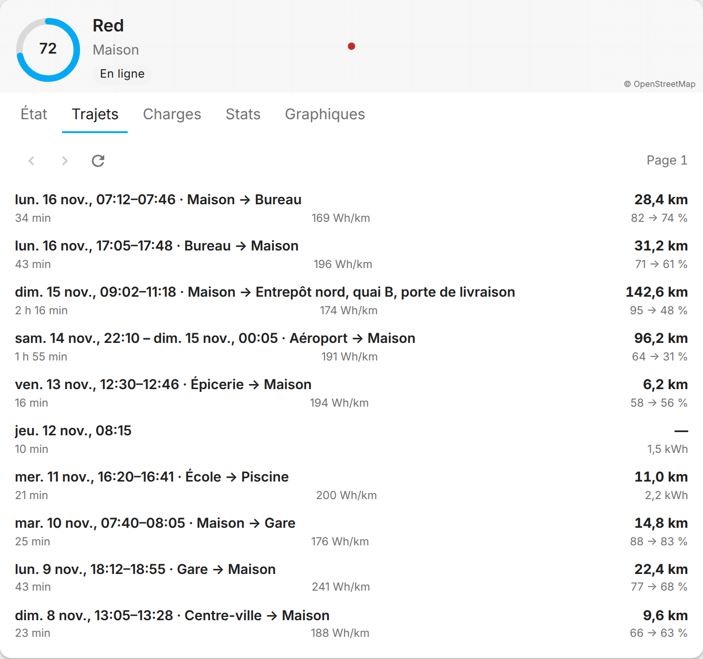

After. The time and the distance line up, and `1,5 kWh` stays in the state-of-charge column when there is no Wh/km.

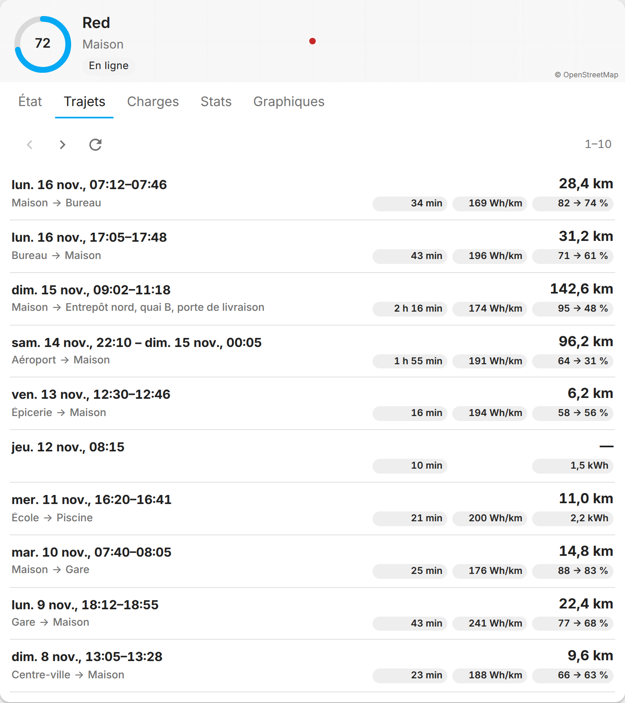

Before, 390px, light. A long date eats the route (`Maison → Bur…`, and the overnight trip hides the places entirely).

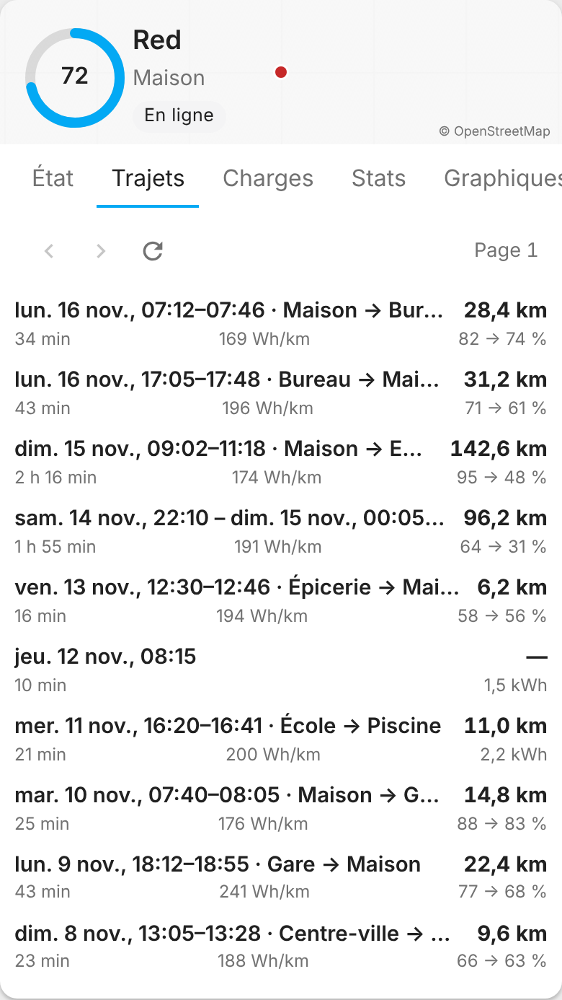

After. The route has its own line, including the long warehouse name. Chips stay complete and aligned.

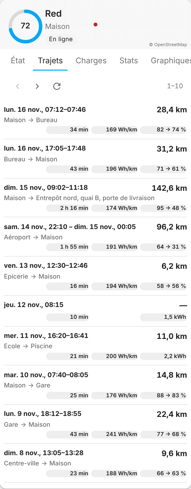

Dark, desktop and 390px:

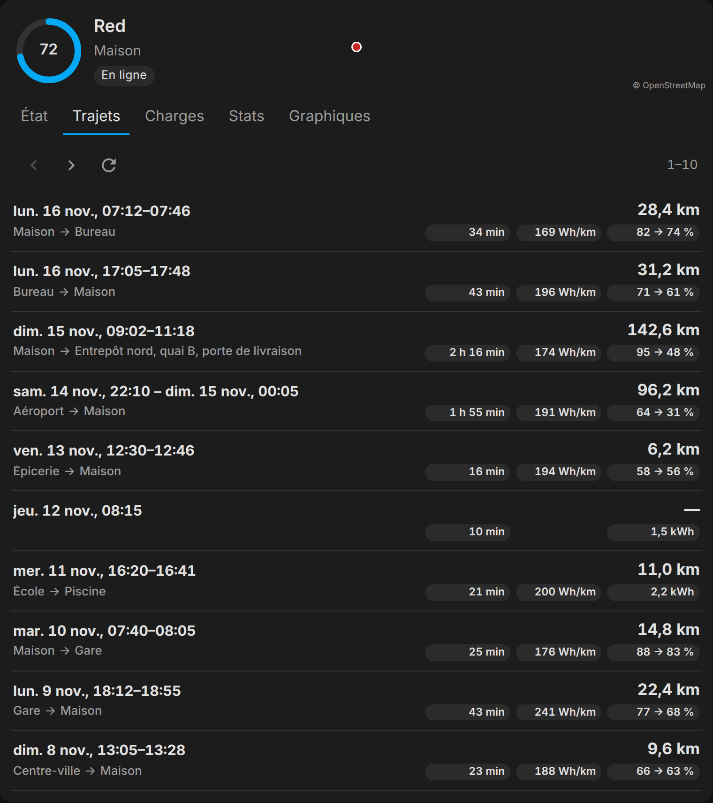

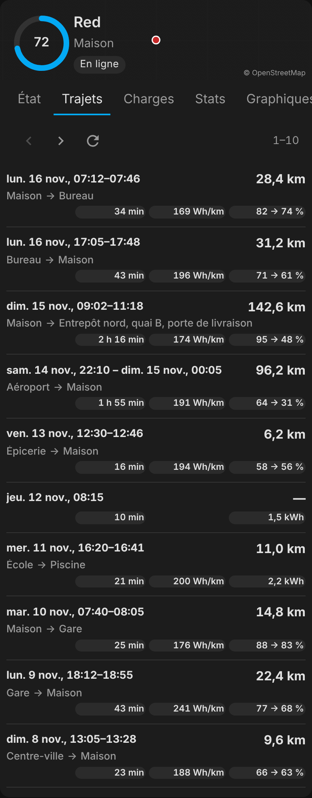

### Charges

The same pattern. Placeholder charger types (`<invalid>`, `none`, `null`) stay hidden. AC/DC and power keep their columns when state of charge is missing.

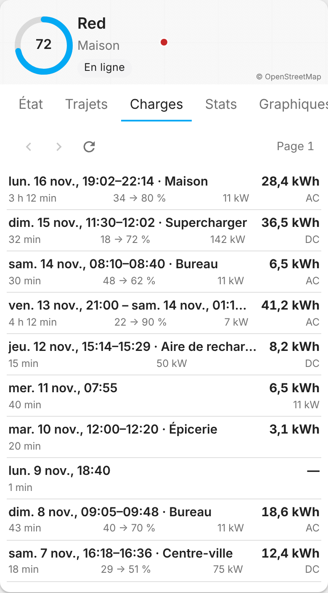

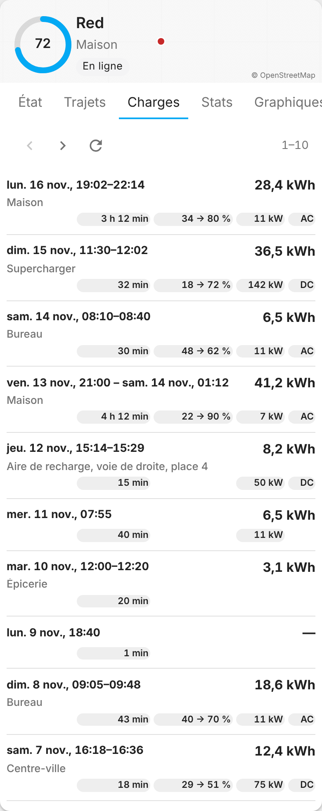

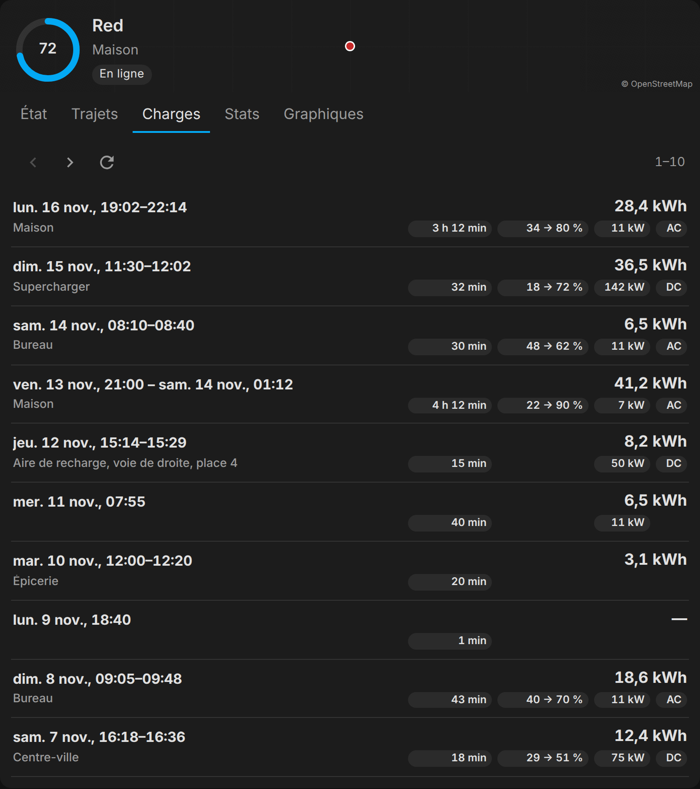

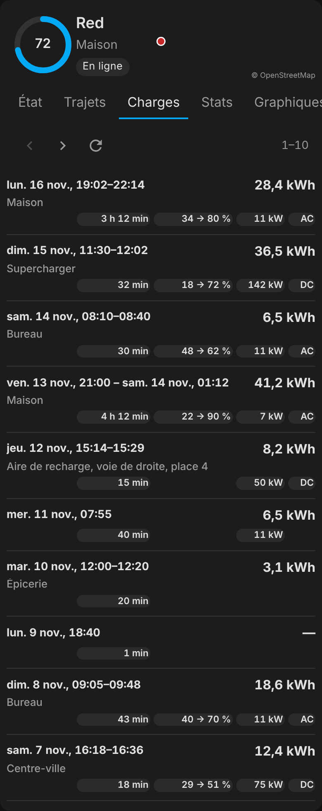

Light desktop before and after, and the dark “before” shots, are in the same folder: `current-charges-light-desktop.png`, `current-charges-dark-desktop.png`, `current-charges-dark-mobile.png`, `charges-light-desktop.png`.

## Header and status

The header is a 72px battery ring, the device name, the geofence, an activity pill, and a faint map with a red point. That map should stay faint. Range was deliberately moved out of the header; it is the first Status tile, and it should stay in Status.

What is weak today:

- The ring shows `72` and only exposes `%` to assistive tech.
- Status is one undifferentiated 2-column grid. Only range has an icon. `Limite` sits alone on the last row. Nothing says which numbers are about driving, the cabin, or charging.
- Zero charger power and zero energy added look as important as the range.

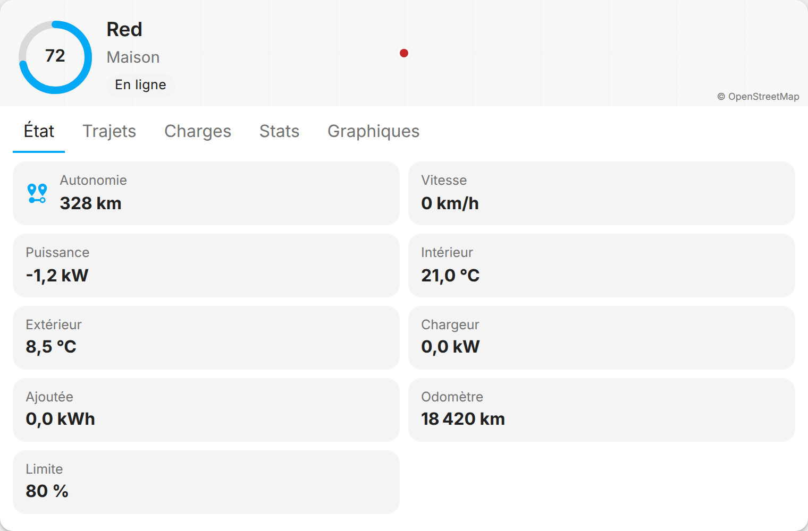

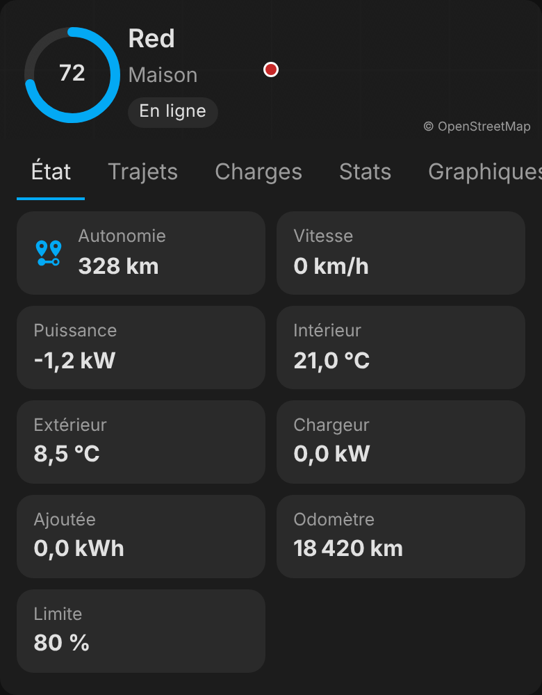

**Proposal.** Keep the watermark and the red point. Put `%` in the ring. Inside Status, put battery and range side by side as the hero pair, then group the other readings (driving, cabin, charging) and use tabular numerals. Hide a charging tile when the car is not charging, instead of showing `0,0 kW`.

**Why.** The eye already goes to the ring for “can I leave”. Range belongs next to that answer, but in Status, which is where it lives today. Grouping makes the nine tiles scannable.

**Effort.** Small for the percent sign and tabular numerals. Medium for the groups and for hiding idle charging tiles, because the activity state has to drive visibility without the grid jumping on every poll.

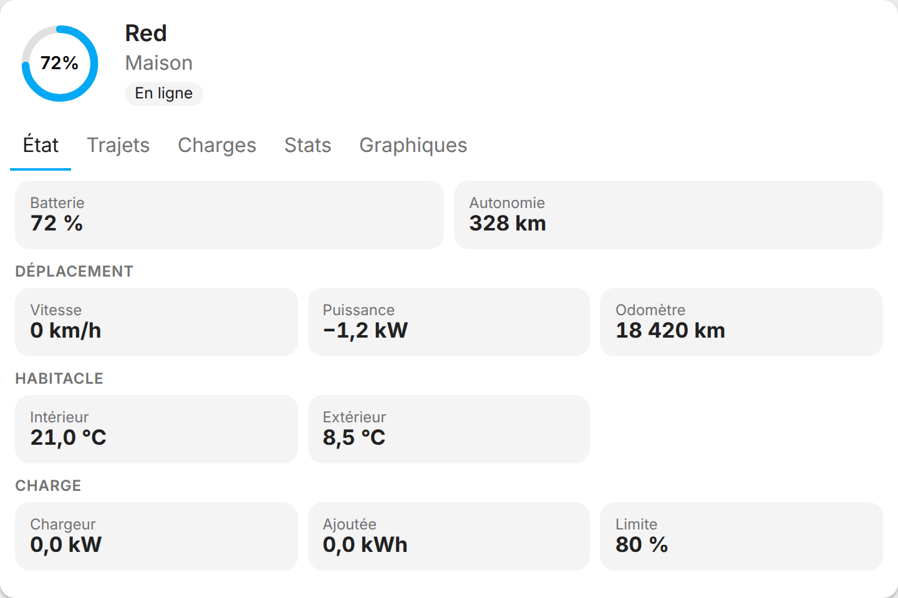

## Tabs

Five text tabs scroll in a row. At 390px, `Graphiques` is clipped and there is no hint that the row scrolls. The selected state is only a 2px underline.

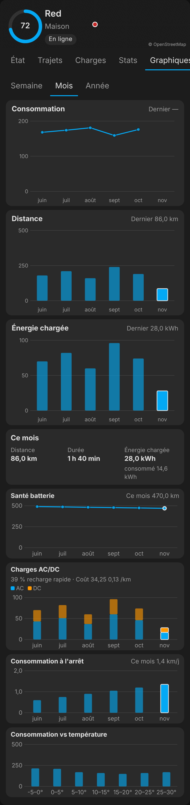

**Proposal.** Under 420px, reduce horizontal padding so the five current labels fit, and add a short fade on the trailing edge if the row overflows later. Keep the 40px target. Do not replace the labels with icons only.

**Why.** The clipped label is the whole problem. Icons without text would need a second learning step for a card that already has five obvious names.

**Effort.** Small.

## Stats

Stats repeats the Status tile style for the selected week, month, or year. There is no comparison with the previous period, so `642,4 km` has no scale.

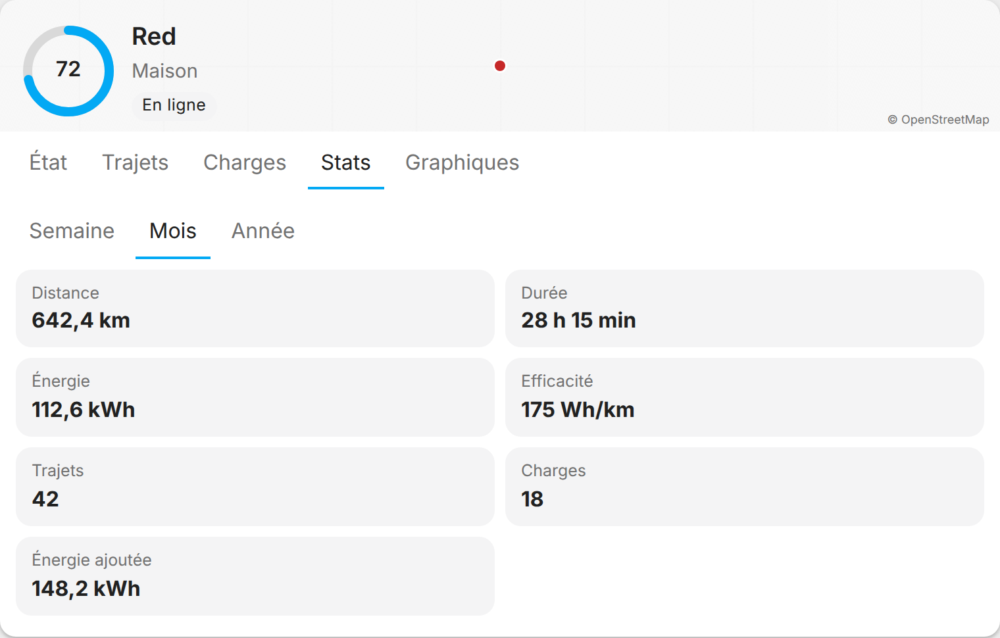

**Proposal.** Make distance the headline and show the previous period beside it (`642 km · mois précédent 510 km`) once the series endpoint can supply that neighbour. Keep the other tiles, with tabular numerals.

**Why.** A single period total is hard to judge. The series view already has the previous bucket; Stats should not invent a second copy of the charts.

**Effort.** Medium. The card can derive the previous bucket from `get_stats_series` instead of adding a field, but Stats would then depend on that call.

## Charts

Three large charts stack, then a totals strip, then four smaller charts. On a phone that is a long scroll (`current-charts-dark-mobile.png` above). Two concrete bugs:

- Main charts headline the **last** bucket, not the selected one. November has no Wh/km, so consumption reads `Dernier —` while June–October are drawn.
- The AC/DC note concatenates the cost and the cost per kilometre: `Coût 34,25 0,13 /km`. The per-km span is inline, so it never starts a new line and it has no separator.

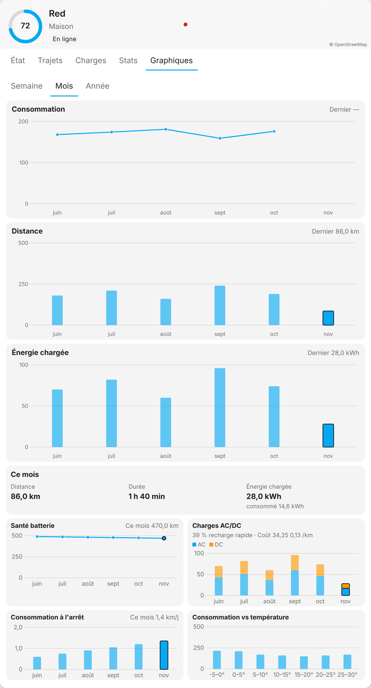

**Proposal.**

- One primary chart with a Consommation / Distance / Énergie switch. The extras (health, AC/DC, parked, temperature) stay below, collapsed under a disclosure on narrow screens.
- Headline the selected bucket. If that bucket is null, say which month was used instead (`oct. · 176 Wh/km`).
- Render the cost line as `39 % recharge rapide · Coût 34,25 · 0,13 /km`.

**Why.** Three charts of the same months repeat the x-axis. The dash headline hides that the series is fine. The cost line is a one-line template bug.

**Effort.** Small for the cost separator and the null headline. Medium for the switcher and the disclosure.

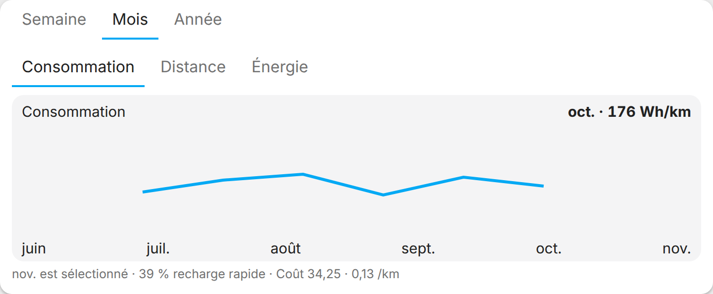

## Drive detail

The back control is an icon button plus the word Back. Keep both. The map and the three sparklines (speed, elevation, battery) follow. The sparklines are 56px tall and have no scale. The detail never repeats the start and end addresses that the list just showed.

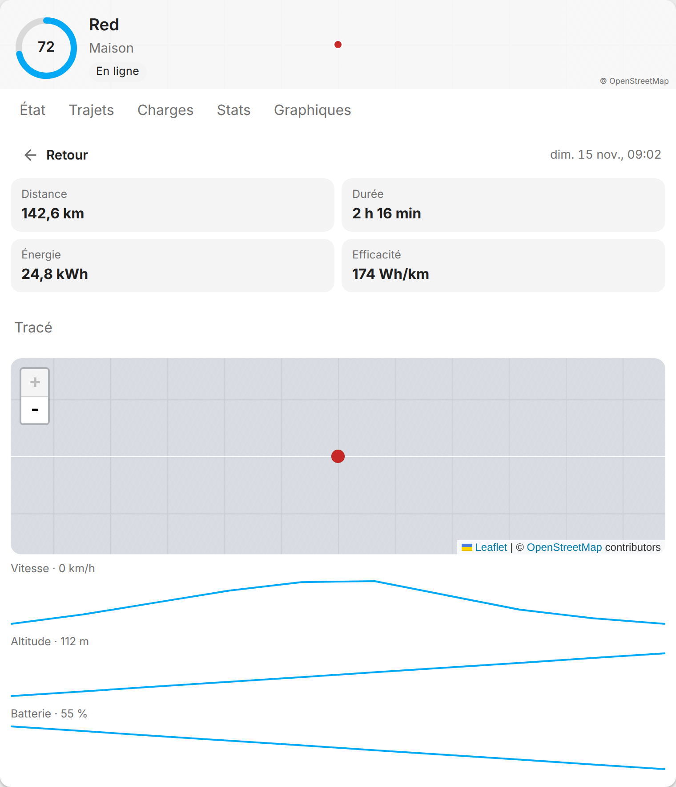

**Proposal.** Under the toolbar, show `start → end` with the same ellipsis rules as the list. Give each sparkline a min–max label and about 90px of height. Leave the route map as it is.

**Why.** Opening a drive currently drops the only place names. A 56px line without a scale is decorative.

**Effort.** Small for the place line (the drive payload already has the addresses). Medium if the three sparklines become one chart with a series switch, matching the charts proposal.

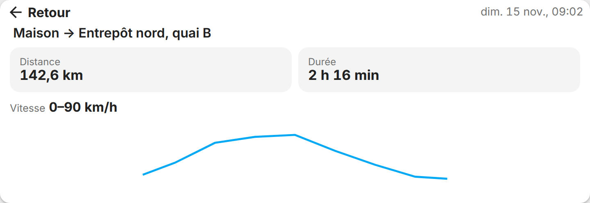

## Editor

The editor is Home Assistant’s `ha-form`. Field labels go through `computeLabel` and follow the UI language. The default-view **options** are hardcoded English in `SCHEMA` (`Status`, `Drives`, `Charges`, `Stats`, `Charts`), so a French card still offers English choices. The show flags are one flat grid of booleans.

**Proposal.** Build the select options from the same copy table as the tabs. Split the booleans into “Views” and “Charts”. Keep `ha-form`; this is schema data, not a custom editor.

**Why.** The card and the editor should name the views the same way. Twelve booleans in one grid are hard to scan, and a wrong default view is easy to set when the labels don’t match the tabs.

**Effort.** Small.

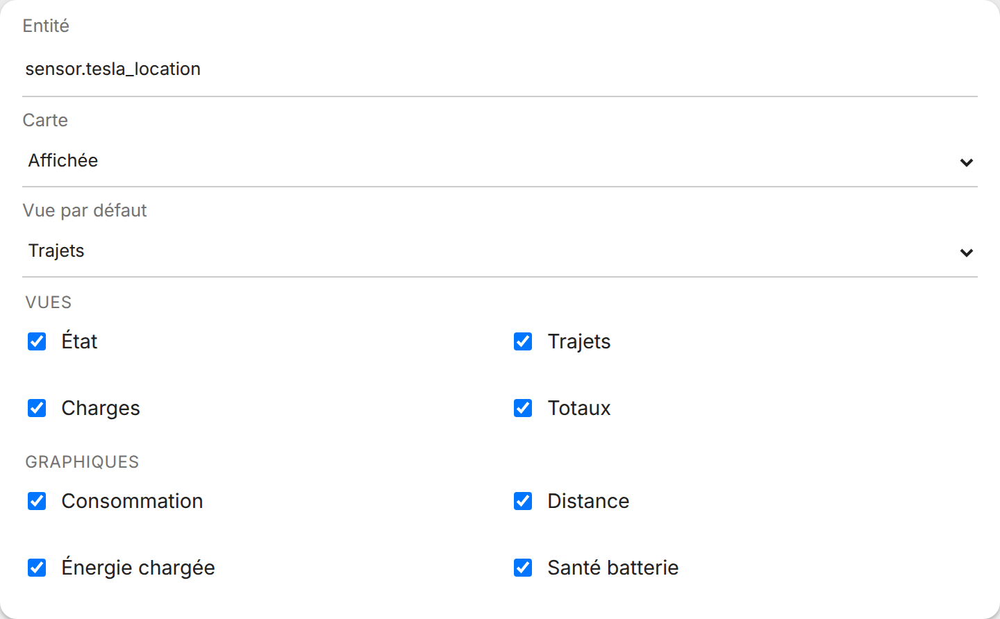

## Follow-up for the lists

Day headings (`lun. 16 nov.`) would let each row start at the clock time. The 0.1.12 columns stay. Not in this version: the date-in-the-row form already answers “when” without a new grouping pass, and a heading plus a time-only row is easy to get wrong across midnight and across time zones.

**Effort.** Small once the grouping uses `formatListRange`’s calendar day.

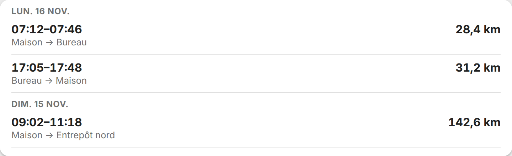

## Left as they are

- Header map opacity, grayscale, and the red point.
- Range as a Status metric, not a second line in the header.
- Service calls still go through Home Assistant. The browser still never sees the API token.
- Lazy chunks and the `.gz` / `.br` siblings. 0.1.12 only changes the card chunk and the `?v=` query.
